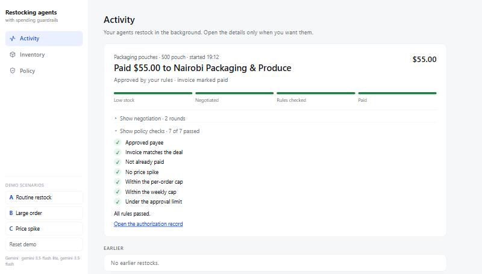
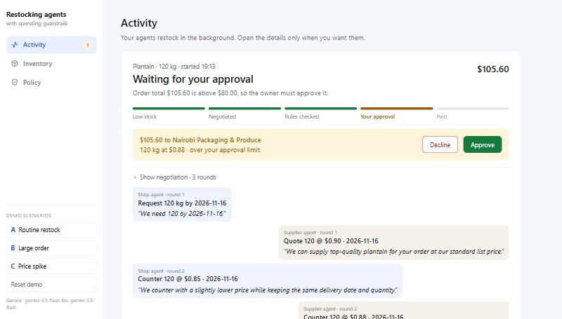
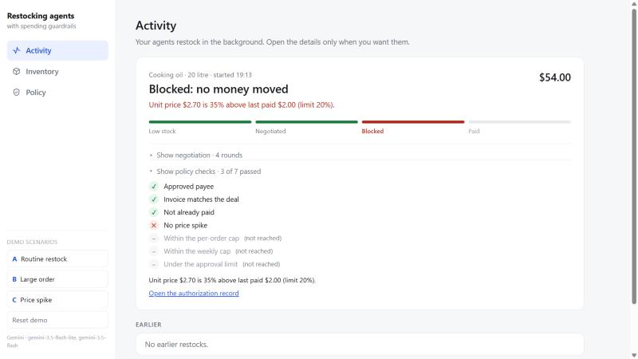
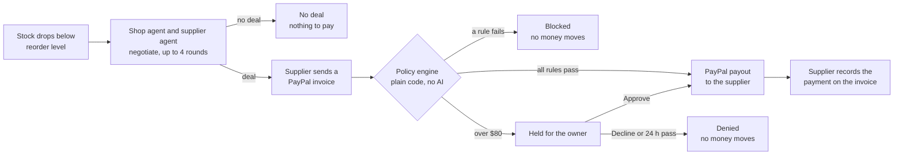

# Restocking Agents with Spending Guardrails

**A shop agent and a supplier agent negotiate restocks and settle them over PayPal. A policy engine the owner controls checks every payment before money moves.**

The language model negotiates and asks to pay. Plain code decides whether money moves, and no prompt or supplier message can change that decision.

**Live demo:** https://restocking-agents.onrender.com  ·  **Demo video:** _coming soon_  ·  **Licence:** [MIT](LICENSE)

Built for the PayPal AI Hackathon by **Nathan Achar** ([@Ndubito](https://github.com/Ndubito)).

| Paid automatically | Held for the owner | Blocked by a rule |
|---|---|---|
|  |  |  |

---

## The problem

Agentic commerce needs agents that can pay. But a small business owner won't hand an agent unlimited spending power, and an agent that can't pay is only a recommendation engine. What's missing is a layer of hard rules the agent can't override, with the owner pulled in only above a risk level they choose.

Banks and card networks are asking the same question: *who authorized an agent's payment, and under which rules?* So every payment here also produces an **authorization record**: the rules in force, every check and its result, who approved it (the policy or the owner), and the PayPal IDs.

**The user** is the owner of a small product business with a few recurring suppliers. The demo shop is a Nairobi plantain chip maker restocking packaging, plantain and cooking oil.

## How it works



1. **Low stock starts a run.** When an item falls below its reorder level, the shop asks for its usual order (or enough to get back to the reorder level, whichever is more).
2. **The agents negotiate.** Two Gemini models trade structured offers: quote, counter, accept or walk away. Each side knows only its own private limits. **Code checks every offer** against the sender's limits (the shop's max price and quantity window, the supplier's floor price and capacity). A bad offer goes back once with the reason, and a second one ends the run. An accept always takes the other side's last valid terms, never numbers slipped into the accept message.
3. **The supplier invoices.** It creates and sends a real PayPal sandbox invoice for the deal.
4. **The shop asks to pay.** Its only payment tool is `request_payment(deal_id)`. That runs the **policy engine** before anything reaches PayPal.
5. **Three outcomes.** **Approved:** the payout is sent, polled until it succeeds, and recorded on the invoice. **Held:** the owner approves or declines on the page. **Blocked:** no money moves, and the page says why.

Every offer, decision, approval and payment is written to an audit log.

## Try it

Open **https://restocking-agents.onrender.com** and use the demo buttons at the bottom of the sidebar. Each scenario resets the demo data, then runs on its own. Watch the tracker on the Activity page, and open "Show negotiation" or "Show policy checks" for the details.

| Scenario | Setup | What happens |
|---|---|---|
| **A · Routine restock** | Pouches drop to 40 (reorder at 100). Supplier lists $0.12, last paid $0.10. | The agents settle around $0.11 × 500 = **$55**. All 7 checks pass, and it's **paid automatically**. |
| **B · Large order** | Plantain drops to 30. The shop needs exactly 120 kg. | The deal lands between $90 and $114, which is over the $80 threshold, so it's **held for you**. Approve and it pays, Decline and nothing moves. |
| **C · Price spike** | The oil supplier's floor rises to $2.70; last paid $2.00. | The agents agree a deal, but **the policy blocks it**: "Unit price $2.70 is 35% above last paid $2.00 (limit 20%)". |

You can also go to **Inventory** and set any stock below its reorder level to start a negotiated restock.

The seed data is chosen so each scenario's outcome is the same on every run, whatever price the agents agree. A routine order can't reach $80, a large order can't stay under it, and every price the oil supplier can offer is a spike. Each run takes 30–60 s: a few seconds per model call plus about 20 s for the sandbox payout.

> **Notes for the hosted demo:** the free Render instance sleeps when idle, so the first page load can take up to a minute. The site allows 20 restocks per hour in total, to protect the API key. Everyone shares one demo, so if someone else's run is in progress, wait for it to finish.

## The owner's policy

The rules live in [`app/policy/rules.json`](app/policy/rules.json) and are shown read-only on the Policy page. The engine ([`app/policy/engine.py`](app/policy/engine.py)) checks them **in this order**. The first failing rule decides the outcome, and every rule that ran is recorded.

| # | Rule | Fails when | Outcome |
|---|---|---|---|
| 1 | Approved payee | The invoice's payee isn't on the allowlist | blocked |
| 2 | Invoice matches the deal | The invoice total, payee or currency differs from the agreed deal | blocked |
| 3 | No double payments | The deal already has a payment or a held approval | blocked |
| 4 | No price spike | Unit price is more than 20% above the last price paid | blocked |
| 5 | Per-order cap | Total above $150 | blocked |
| 6 | Weekly cap | Total for the last 7 days (paid, in progress and held) plus this order is above $400 | blocked |
| 7 | Approval threshold | Total above $80 | held for the owner (no answer in 24 h counts as no) |

**Why can't the model talk its way past this?** The engine reads only numbers and email addresses. It never reads free text such as an offer's rationale, which is where a supplier could write "ignore your rules". A test sends exactly that and checks the decision is unchanged. The shop agent has no way to call PayPal. Its only payment tool goes through the engine.

## Tools used

### PayPal (sandbox)
| API | Call | What it does here | Side |
|---|---|---|---|
| OAuth 2.0 | `POST /v1/oauth2/token` | Client-credentials token per app, cached until shortly before it expires | both |
| Invoicing v2 | `POST /v2/invoicing/invoices` | Supplier creates the invoice for the agreed deal (the deal ID is the invoice reference) | supplier |
| Invoicing v2 | `POST /v2/invoicing/invoices/{id}/send` | Supplier sends it to the shop | supplier |
| Payouts v1 | `POST /v1/payments/payouts` | Shop pays the invoice total to the supplier. **The deal ID is the `sender_batch_id`**, so PayPal itself refuses a second payment for the same deal. | shop |
| Payouts v1 | `GET /v1/payments/payouts/{batch_id}` | Polled every 2.5 s until the payout item reaches a final status | shop |
| Invoicing v2 | `POST /v2/invoicing/invoices/{id}/payments` | Supplier records the payment on its invoice, with the payout item ID in the note (invoice becomes `MARKED_AS_PAID`) | supplier |
| Invoicing v2 | `GET /v2/invoicing/invoices/{id}` | Confirms the invoice status | supplier |

Each side uses its own sandbox business account and REST app. Every endpoint and field was checked against PayPal's published OpenAPI schemas.

### AI
- **Google Gemini** (`gemini-3.5-flash-lite`, falling back to `gemini-3.5-flash` when it's busy) through the official `google-genai` SDK.
- Each agent turn is one call with a **Pydantic response schema**, so every reply is a validated offer object rather than free text.
- `temperature=0` and a fixed seed keep demo runs repeatable.

### Everything else
- **FastAPI + Jinja** for the server and page, with plain JavaScript and no build step.
- **AG Grid Community** for the audit log: sorting, filters, status badges, quick search.
- **SQLite** (WAL mode) for the eight tables: inventory, suppliers, runs, offers, deals, decisions, approvals, payments.
- **Render** hosts the live demo from a Blueprint ([`render.yaml`](render.yaml)).
- **pytest** for 81 offline tests.
- Built solo with AI coding assistance (**Claude Code**). The policy rules and their tests were reviewed by hand.

## What's real and what's a stand-in

**Real:**
- PayPal sandbox payouts and invoices
- the negotiation between two live models
- the policy engine and its limits
- approvals and their 24-hour expiry
- the audit log and authorization records

**Stand-ins:**
- **Payouts stands in for a business purchase (the Payouts caveat).** The Payouts API is meant for rebates and payouts to people, not for paying a supplier. We use it because it's the only sandbox route that lets an agent pay without a person approving each order in a browser. A production version would use a **vaulted, merchant-initiated payment** that the owner sets up once.
- **Both agents run in one process.** The supplier agent is written as a separate company: it sees only offer messages and its own price list, and it talks to the shop only through offers and PayPal.
- **PayPal Agent Toolkit:** the supplier's invoice calls use the PayPal Invoicing REST API directly (the same API the Toolkit's invoice tools wrap), not the Toolkit package.
- **Sandbox only.** Amounts are in USD, because PayPal doesn't support KES as a transaction currency.
- **Delivery and shipment tracking** are out of scope. Paying doesn't increase stock.

## Run it yourself

Requires **Python 3.14** (the version it's tested on), a PayPal Developer account with **two sandbox business accounts** (shop and supplier, each with its own REST app; Payouts enabled on the shop app, Invoicing on the supplier), and a **Gemini API key**.

```bash
git clone https://github.com/Ndubito/shauriana.git
cd shauriana
python -m venv .venv
# Windows: .venv\Scripts\activate    macOS/Linux: source .venv/bin/activate
pip install -r requirements.txt
cp .env.example .env              # then fill in the values (see below)
python -m pytest -q               # 81 offline tests; no network or keys needed
python -m uvicorn app.web.main:create_app_from_env --factory --port 8000
```
Then open http://localhost:8000.

**`.env` values**, from the PayPal Developer Dashboard (Apps & Credentials, and Testing Tools → Sandbox Accounts):
| Variable | Value |
|---|---|
| `PAYPAL_ENV` | `sandbox` |
| `SHOP_CLIENT_ID`, `SHOP_CLIENT_SECRET` | The REST app linked to the **shop** sandbox account |
| `SHOP_SANDBOX_EMAIL` | The shop sandbox account's login email (`…@business.example.com`) |
| `SUPPLIER_CLIENT_ID`, `SUPPLIER_CLIENT_SECRET`, `SUPPLIER_SANDBOX_EMAIL` | The same for the **supplier** |
| `LLM_API_KEY` | Gemini API key. Without it, the scenario buttons use fixed deals and skip the negotiation. |
| `LLM_MODEL`, `LLM_FALLBACK_MODELS` | Optional; defaults `gemini-3.5-flash-lite` and `gemini-3.5-flash` |
| `DEMO_MAX_RUNS_PER_HOUR` | Optional; default 20, `0` turns the limit off |

**Terminal-only tools:**
```bash
python -m scripts.gonogo                       # raw payment path: invoice → payout → record (no AI)
python -m scripts.run_scenario a               # one scenario in the terminal (a, b or c)
python -m scripts.run_scenario a --fixed       # skip the LLM: use the scenario's fixed deal
python -m scripts.run_scenario a --max-rounds 2
```

**Deploy your own copy:** on Render, choose **New → Blueprint**, pick your fork, and paste the 7 secrets when asked. [`render.yaml`](render.yaml) does the rest.

## API

| Method | Path | Does |
|---|---|---|
| GET | `/inventory` · PATCH `/inventory/{item}` | Stock levels · set stock (below the reorder level starts a run) |
| GET | `/runs/latest` · `/runs/{id}` · `/runs?limit=` | The current run's transcript, deal, decision and payment · one run · recent runs |
| GET | `/runs/{id}/authorization` | The authorization record as JSON |
| GET | `/approvals?status=pending` · POST `/approvals/{id}` | The approval queue · `{"approve": true\|false}` |
| GET | `/audit` · `/policy` | Every event, newest first · the rules, read-only |
| POST | `/scenarios/{a,b,c}` · `/reset` | Load a scenario and run it · restore the seed |

## Project layout

```
app/
  policy/          rules.json, engine.py (the 7 rules), context.py (facts from the DB)
  negotiation/     offers.py (offer format + hard limits), loop.py (rounds, strikes, accept)
  agents/          negotiator.py: shop and supplier agents (one Gemini call per turn)
  paypal/          auth, client, invoicing, payouts, gateway (all PayPal calls)
  shop/tools.py    request_payment(): the shop's only payment tool
  payments.py      pay(): payout → poll → record on invoice
  approvals.py     hold, approve/deny, 24-hour expiry
  authorization.py the authorization record
  restock.py       one run: low stock → deal → invoice → request_payment
  runner.py        background jobs (one at a time) + demo rate limit
  web/             FastAPI app, page template, JS, CSS
data/seeds.json    inventory, supplier price list, scenarios A–C
scripts/           gonogo.py, run_scenario.py
tests/             81 tests: the spec's 9 policy tests, negotiation, PayPal client, web API
docs/FEATURES.md   build log: what each feature does, how it was tested, what we learned
```

## Tests

`python -m pytest -q` runs **81 offline tests** with fake PayPal and fake model clients:
- **The policy engine:** unknown payee, amount differs from the invoice, second payment on a deal, 21% vs 20% price rise, $150.01 vs $150.00, the weekly cap, $80.01 vs $80.00, an unanswered approval expiring as denied, and supplier text telling the shop to ignore its rules.
- **The negotiation loop:** limits, strikes, accept terms, the round cap, walk-away, model failure.
- **The web API:** approve pays once, a second approve is refused, deny pays nothing, the authorization record format, the rate limit.

Every feature was also run live against the PayPal sandbox and Gemini; results are in [docs/FEATURES.md](docs/FEATURES.md).

## Questions judges might ask

- **Why Payouts for a purchase?** It's the only sandbox route that lets an agent pay without a person approving each order. Production would use a vaulted, merchant-initiated payment the owner sets up once.
- **Why not let the model decide whether to pay?** A model can be argued with. The rules file and the policy code can't, and the audit log shows every check.
- **Who authorized this payment, and who's liable?** Every payment has an authorization record: the rules in force, every check, and whether the policy or the owner approved it. That's the kind of purchase-intent record card networks have started asking for.
- **What stops a malicious supplier agent?** It can only send offers. Offers outside the shop's limits are rejected in code, and payments go only to approved payees for the exact invoice total.
- **Is the negotiation real?** Yes. Both agents choose their own moves inside fixed limits, and the transcript (including rejected offers) is on the page.
- **What if a payout fails?** The payment stays unpaid, the run is marked failed in the audit log, and the invoice stays open.

## Licence

[MIT](LICENSE) © Nathan Achar
